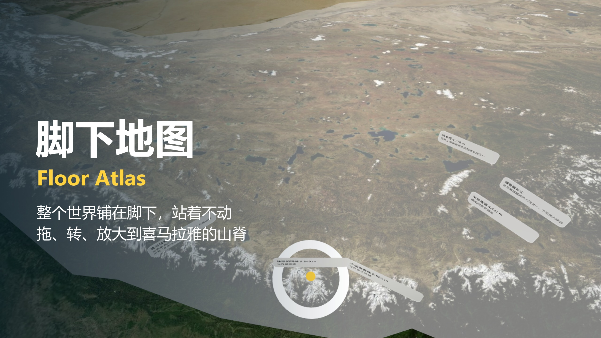
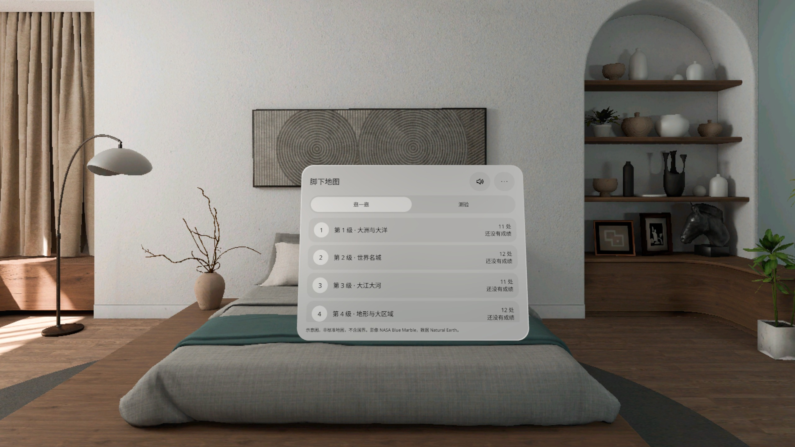
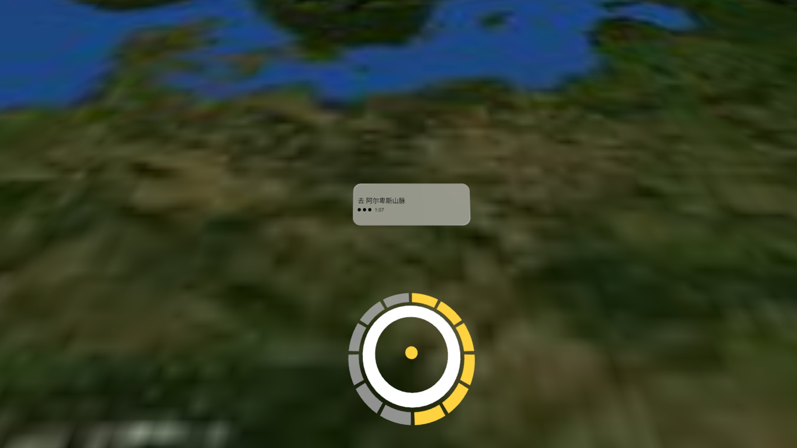
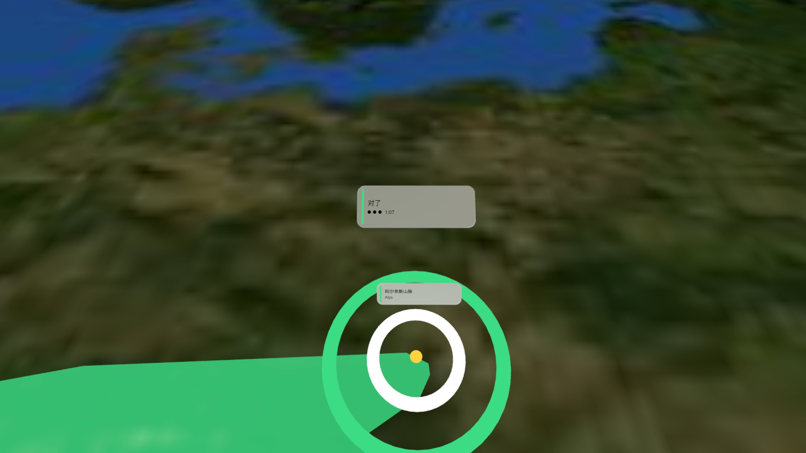
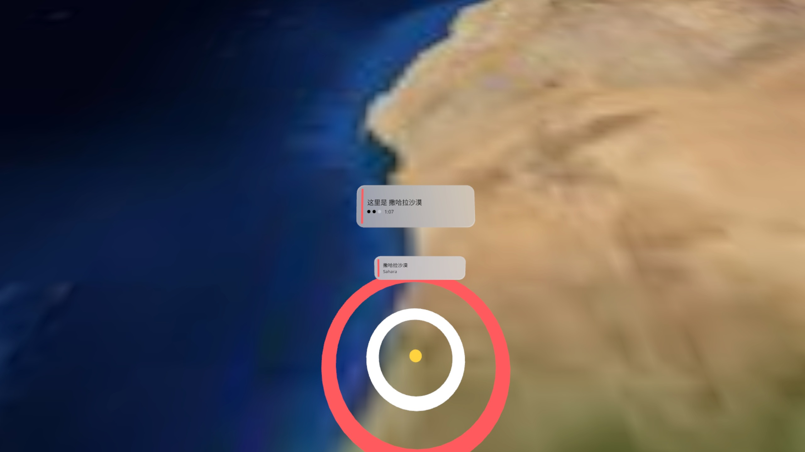
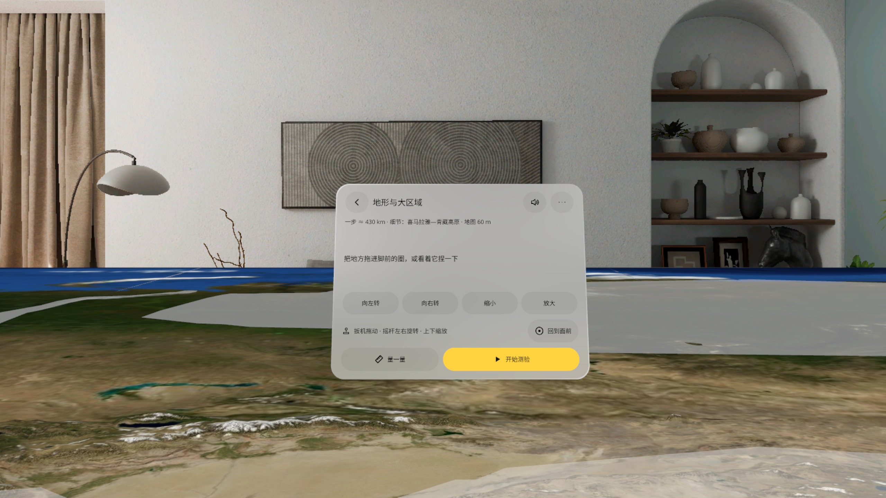
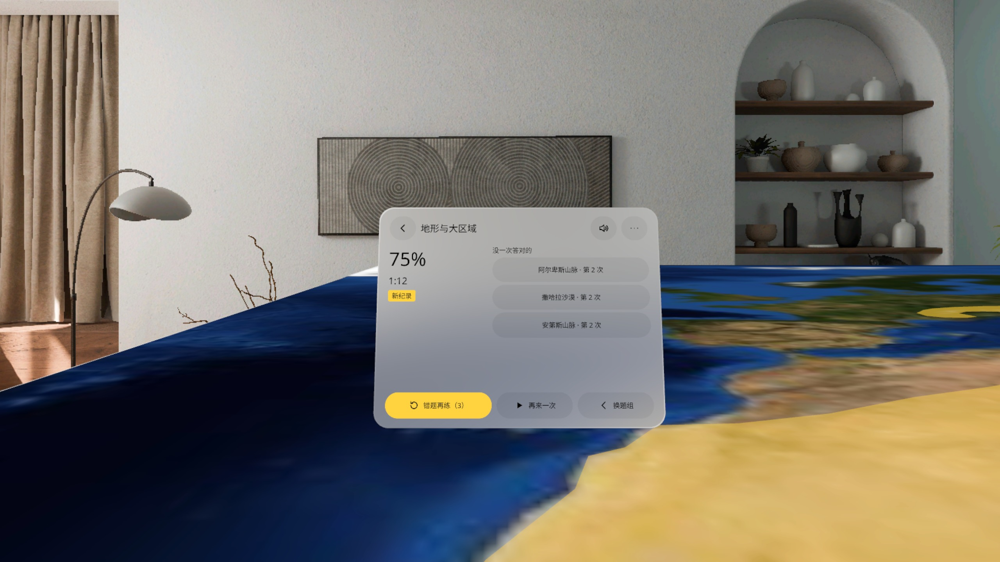

# Floor Atlas · 脚下地图



**中文** · [English](#english)

一张写实卫星地形的世界地图铺在你脚下。人站着不动，用手柄把地图拖过来、转过来，一直放大到看清喜马拉雅的山脊和冰川；听到「去撒哈拉」，就把撒哈拉拖进脚前的准星圈。

PICO OS 6 空间应用（PICO Spatial SDK · Full Space · Stage · 透视混合现实）。

## 功能

- **逛一逛**：拖动平移、摇杆左右转、上下缩放；地图长边 2.4 m（整个世界）到 98 m（地板上 1 mm ≈ 0.4 km），越放大越清楚，地形真实起伏
- **三个精选地貌区**带地貌名牌：喜马拉雅—青藏高原、科罗拉多高原—大峡谷、东非大裂谷—乞力马扎罗
- **测验**：6 个题组 67 处，由简到难——大洲与大洋、世界名城、大江大河、地形与大区域、海与海湾、湖泊与内海；念题、计时、最好成绩、错题回顾
- **把目标拖到脚下作答**：停稳 0.8 秒判定，对 / 错有颜色和声音反馈，3 次不中自动揭晓
- **量一量**：两地的大圆距离、地图上的长度和步数
- 扫不到地面时用估计高度，可在菜单里微调；静音键在题板顶栏
- 中英双语，全部本机运行，不联网、不需要账号

## 截图

| | |
|---|---|
|  选题组 |  准星停稳，进度环走满就判定 |
|  答对：目标亮绿 |  答错：红圈 |
|  放大到青藏高原 |  成绩与错题回顾 |

截图来自 PICO 模拟器 6.1，由调试广播驱动，**不是真实手势录像**。

## 安装

```bash
adb install -r FloorAtlas-v0.1.1.apk
pico-cli app launch io.embodit.flooratlas
```

APK 在 [Releases](https://github.com/kejing-dev/FloorAtlas/releases)。构建、结构和调试广播见 [AGENTS.md](AGENTS.md)。

## 数据与许可

- 影像：NASA Blue Marble Next Generation（经 NASA GIBS），NASA 影像注明来源即可使用
- 高程：AWS Terrain Tiles（ETOPO1 / SRTM / GMTED）
- 形状与地名：Natural Earth（公有领域）；字体 Noto Sans（OFL）
- **示意图，非标准地图，不含国界**。v1 只做海外与内部展示，不在中国境内公开发布

---

<a id="english"></a>

## English

A photo-real relief map of the world lies on your floor. Stay where you are: drag and turn the map with the controller, and zoom in until you can see the ridges and glaciers of the Himalaya. Hear "Go to the Sahara", then drag the Sahara into the ring at your feet.

PICO OS 6 spatial app (PICO Spatial SDK · Full Space · Stage · passthrough mixed reality).

### Features

- **Explore**: drag to pan, stick left/right to turn, up/down to zoom. The map's long edge goes from 2.4 m (whole world) to 98 m (1 mm on the floor ≈ 0.4 km), sharper imagery as you zoom, with real terrain relief
- **Three featured regions** with landform labels: Himalaya–Tibetan Plateau, Colorado Plateau–Grand Canyon, East African Rift–Kilimanjaro
- **Quiz**: 6 sets, 67 places, easy to hard — Continents & Oceans, World Cities, Great Rivers, Landforms & Regions, Seas & Gulfs, Lakes & Inland Seas; spoken prompts, timer, best scores, review of misses
- **Answer by dragging the target to your feet**: hold still for 0.8 s; colour and sound feedback; the answer is revealed after 3 misses
- **Measure**: great-circle distance, length on the map and number of steps between two places
- Falls back to an estimated floor height (adjustable) when no floor is found; mute button on the quiz panel
- Chinese and English, fully offline, no account needed

### Install

```bash
adb install -r FloorAtlas-v0.1.1.apk
pico-cli app launch io.embodit.flooratlas
```

Get the APK from [Releases](https://github.com/kejing-dev/FloorAtlas/releases). Build, structure and debug broadcasts: [AGENTS.md](AGENTS.md).

Screenshots come from the PICO 6.1 emulator driven by debug broadcasts, **not a real hand-gesture recording**.

### Data and licences

- Imagery: NASA Blue Marble Next Generation (via NASA GIBS), free to use with credit
- Heights: AWS Terrain Tiles (ETOPO1 / SRTM / GMTED)
- Shapes and names: Natural Earth (public domain); font Noto Sans (OFL)
- **Sketch map, not a standard map; no borders.** v1 is for overseas and internal showcase only, not published in mainland China
